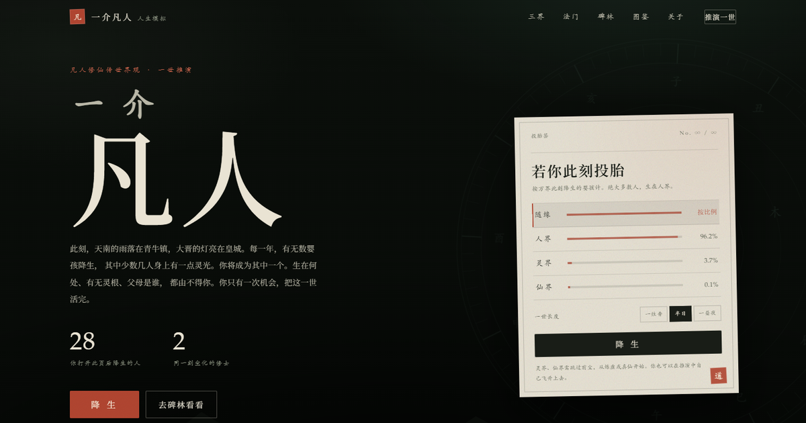
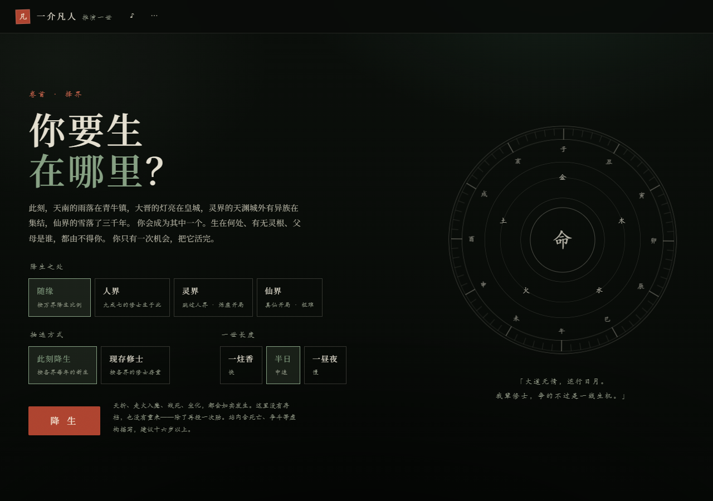
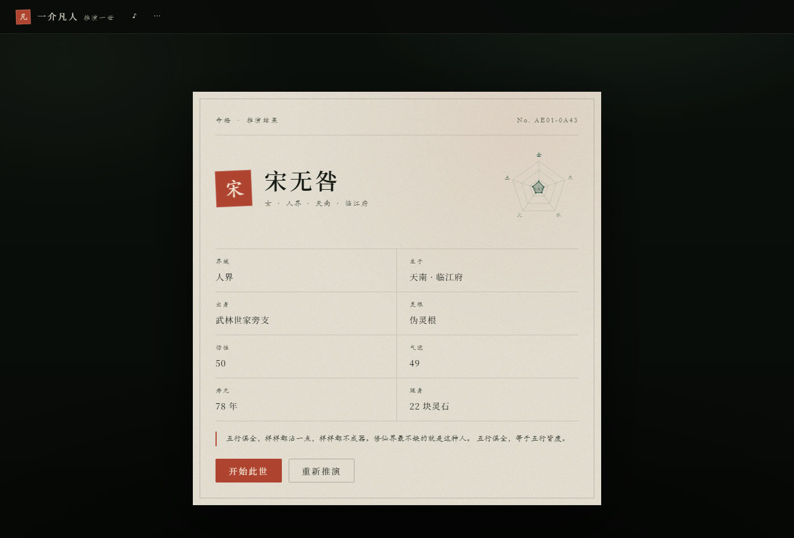
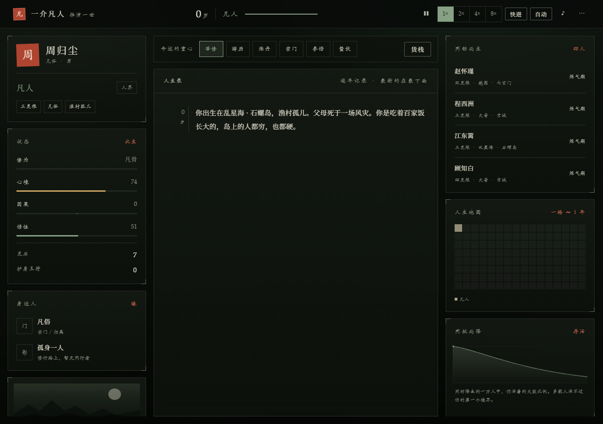
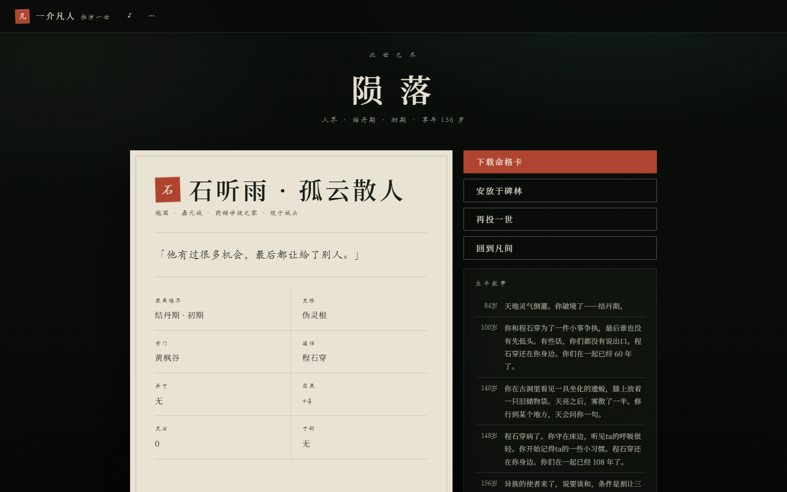
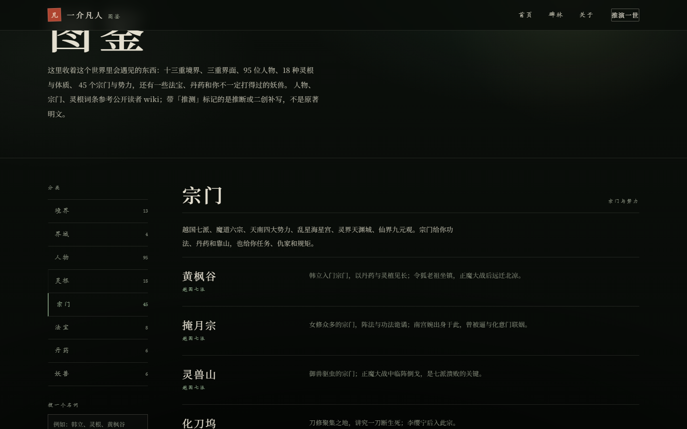

<!--
知乎发布提示：
1. 直接把正文粘贴到知乎编辑器；
2. 图片是相对路径，粘贴后请把 images/ 下的 6 张图逐张上传到对应位置；
3. GitHub 地址和在线试玩地址都在文中，发布前可替换成你自己的追踪链接。
-->

# 我做了个《凡人修仙传》同人修仙模拟器：随机出生，活完一生

> 从青牛镇到天南，从乱星海到灵界、仙界。  
> 你只有一次机会，把这一世活完。

## 先说怎么玩

在线直接打开，手机也能玩：

**https://wang1375830242.github.io/yijie-fanren/**

不用注册，不用下载，没有广告。点「降生」，系统会随机给你一个出身、灵根和寿元，然后一年一年往下走。

GitHub 仓库在这里，欢迎 star、提 issue、补充设定：

**https://github.com/wang1375830242/yijie-fanren**

## 这是什么

一个以《凡人修仙传》世界观为背景的纯网页修仙人生模拟器。

灵感来自 [1in8b.life](https://1in8b.life/zh-hans/) 的「随机出生、活完一生」框架，但我把它换成了凡人流的修仙世界：人界、灵界、仙界，炼气到道祖，灵根、宗门、法宝、丹药、妖兽、道侣、因果。

这是非官方同人作品，不使用原著正文；人物、宗门、灵根参考公开读者 wiki，带「推测」标记的是读者推断或二创补写，不冒充原著明文。

## 开局：你生在哪里，由不得你

每次降生都会随机生成：

- **14 种凡人出身**：山村农家、药铺学徒、七玄门外门杂役、武林世家旁支、没落修仙家族、皇城商贾、渔村孤儿、镖师之子、猎户之家、采药人、渡船人家、牧场人家、矿工之家……
- **灵根**：凡骨、伪灵根、四灵根、三灵根、双灵根、异灵根、天灵根；天灵根大约百中无一
- **界面**：人界 96.2%，灵界 3.7%，仙界 0.1%
- **姓名、性别、寿元、悟性、气运、随身灵石**也都是随机的

没有固定主角光环。你可能生在黄枫谷外的猎户家，也可能生在乱星海的渔村，或者一睁眼就在天渊城的军户人家。

命格卡会先把这一世的底牌摊开。看完可以「重新推演」，也可以直接「开始此世」。

## 一世：每年都在做选择

游戏按年推进，支持 1x / 2x / 4x / 8x，也可以快进或自动。

核心不是「点点点升级」，而是：

- 修炼、游历、炼丹、宗门、参悟、蛰伏……不同选择影响修为、心境、悟性、气运、灵石、因果
- 修为满了要突破，突破有失败和寿元风险
- 寿元耗尽、心魔、战斗、秘境、空间节点，都会真的死
- 这一世不能读档；死了就是这一世的结局，只能再投一世，带着新的随机命格重新开始
- 死亡后可以安放于碑林，留下一句墓志铭

## 2063 个事件，尽量不让你看到重复

目前事件池 **2063 条**，其中：

- **400 条童年事件**，2 岁起就可能触发；3 岁、7 岁各有一个随机童年片段
- **92 条道侣相关事件**，结为道侣后对方会持续出现在后续人生里
- 宗门、灵界、仙界、魔界、战争、市集、秘境、心魔、寿元等主题
- 绝大多数事件一世只触发一次；同一世里尽量不刷屏重复

开局也不再是固定四句环境描写：14 种出身、16 条凡人环境文本、五岁问心 4 种变体，前十年每局会有明显不同的走向。

## 道侣不是一次性的数值

结为道侣或成亲后，后续事件会继续提到对方：一起过日子、对方受伤、对方突破、对方先走、留下一句话。

上面这张结局里的「程石穿」，就是这一世陪到最后的人。

## 图鉴：95 位人物、45 个宗门、18 种灵根

- **人物**：韩立、南宫婉、紫灵、银月、厉飞雨、墨大夫、墨彩环、张铁、李化元、令狐老祖、向之礼、元瑶、温天仁、六道极圣、王蝉、燕如嫣、凌玉灵、冰凤、大衍神君、古或今、轮回殿主、李元究、弥罗、金童、啼魂……
- **宗门**：越国七派、魔道六宗、云梦三宗、星宫、逆星盟、阴罗宗、天符门、天渊城、九元观、轮回殿……
- **灵根**：天/异/双/三/四/五灵根、凡骨，以及暗、雷、冰、风、木、水系天灵根、木土天灵根、通玉凤髓、七星月体等
- 还有 13 重境界、3 重界面、法宝、丹药、妖兽

原著没有写死的最终境界和归属，统一写「原著未明」，并加「推测」标记；不把读者推断冒充原著。

## 一些细节

- 纯静态 HTML / CSS / JS，无构建、无 npm、无外部字体和 CDN，断网也能玩
- 手机适配，竖屏可玩
- 有「柔化模式」，把死亡和血腥措辞换成更克制的表达，但事件仍在
- 在线 GitHub Pages 是静态版，碑林为本机模式；本地运行 `server.py` 可以开公共碑林
- 不需要登录，所有页面打开即玩

## 来活一世

**在线试玩：**  
https://wang1375830242.github.io/yijie-fanren/

**GitHub：**  
https://github.com/wang1375830242/yijie-fanren

如果你也看《凡人修仙传》，欢迎在评论区说说：

> 你第一世，活到了什么境界？死在了哪里？

---

*非官方同人作品，不使用原著正文；《凡人修仙传》版权归原作者忘语及相关权利人所有。*
